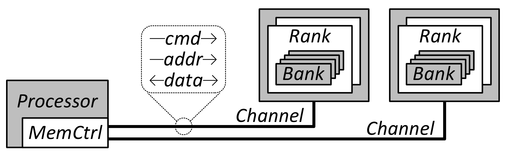
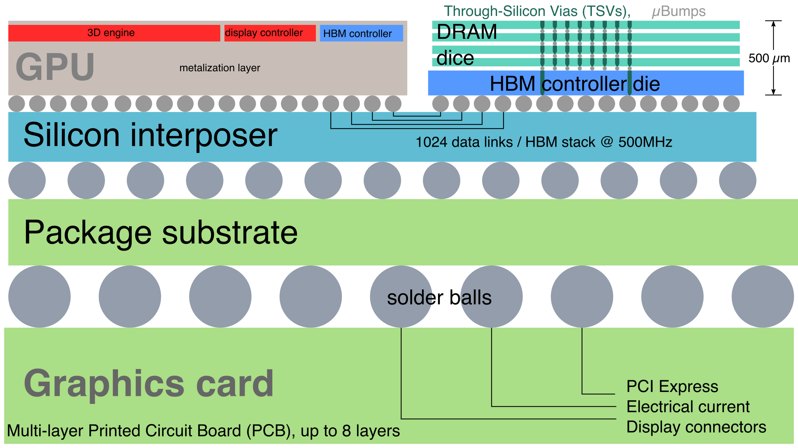
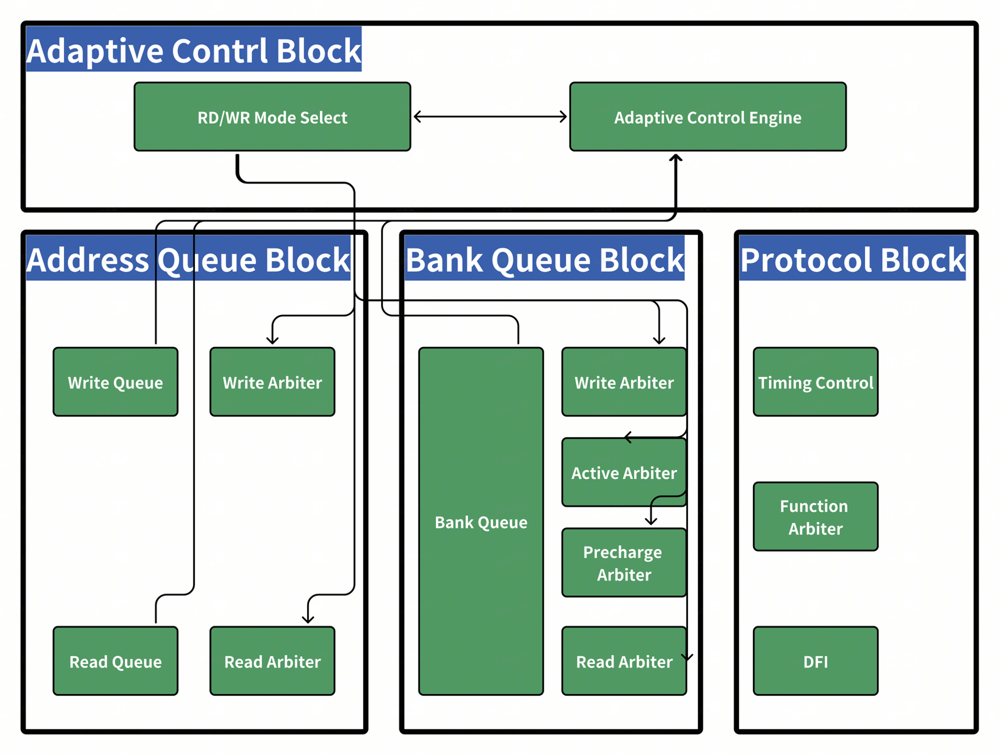
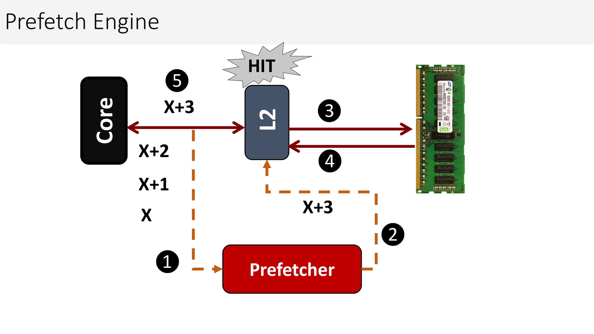

# DRAM, HBM, Memory Controllers, and Prefetching

## DRAM Memory Subsystem

DRAM stores each bit as charge in a tiny capacitor. The cell is dense but destructive reads, leakage, refresh, and
long internal wires make access slower and more structured than SRAM.



*Figure: Logical main-memory hierarchy from [Kim et al., SALP, Fig. 2][dram-hierarchy-figure].
The rank-level banks represent corresponding banks across cooperating DRAM devices, not entire chips.*

### Hierarchy

A controller connects to channels/subchannels serving DIMMs or packages. Each rank groups DRAM devices that
operate in parallel. Within a device, banks may be grouped into bank groups; each bank contains rows and columns
of cells and sense amplifiers that buffer the activated row. Bank groups are technology-dependent.

A memory request is mapped to channel/subchannel, rank, bank, row, and column fields; exact fields vary by memory
technology and controller mapping.

The row buffer holds the active row; it does **not** contain the array of all rows.
A DIMM is a physical module, while a rank is a logical set of devices selected together to supply its interface
width. A DIMM may contain multiple ranks; physical front/back placement alone does not define rank count.
Ranks on the same channel normally share the data bus, so extra ranks add capacity/overlap opportunities,
not separate channel bandwidth automatically.

Independent channels have separate command/data paths and can target unrelated requests concurrently.
For example, two independent 64-bit channels can select different rows, whereas two 64-bit paths operated
in lockstep form a 128-bit interface to the same coordinated access. Both have 128 aggregate data wires;
the distinction is independent scheduling versus a wider combined transfer, not pin count alone.

### Worked rank and cache-line transfer

For the chapter's conventional **64-bit, non-ECC rank**, eight x8 DRAM devices operate in lockstep.
Each device contributes 8 bits per transfer beat; together they supply `8 * 8 = 64 bits = 8 bytes`.
The same bank/row/column selection reaches all eight devices, each holding a different byte lane.

| Transfer beat | Device 0 | Device 1 | ... | Device 7 | Combined data |
| --- | --- | --- | --- | --- | --- |
| 0 | Byte 0 | Byte 1 | ... | Byte 7 | First 8 bytes |
| 1 | Byte 8 | Byte 9 | ... | Byte 15 | Next 8 bytes |
| ... | ... | ... | ... | ... | ... |
| 7 | Byte 56 | Byte 57 | ... | Byte 63 | Last 8 bytes |

Each device selects successive column data from its open row. One 64-byte cache line needs eight 8-byte beats.
For DDR burst length 8, those beats occupy four data-clock periods, not eight full clock cycles. A burst READ
initiates the sequence; this is not eight independent READ commands. Activation and read latency precede the
data burst, so four clocks is not the total access latency. DDR5 subchannels and HBM use different organizations.

The rank presents a wide interface without making the controller address each x8 device individually.
That grouping also sets transfer granularity: one beat on this rank supplies eight bytes, and the BL8 example
transfers 64 bytes even when a CPU needs one word. Byte-write masks and other organizations can change useful
write granularity; interface width, DRAM burst size, and CPU cache-line size are distinct quantities.

### Row-buffer operation

A conventional DRAM cell uses **one access transistor and one storage capacitor (1T1C)**:

- The **wordline** turns on the access transistor, connecting the cell capacitor to its **bitline**.
- Charge sharing with the precharged bitline creates a small voltage change representing the stored bit.
- A **sense amplifier** detects and amplifies that change, then restores the capacitor's charge. Reading initially
  disturbs the stored charge; restoration is part of activation, not an optional later software write.
- Lowering the wordline isolates the capacitor. Leakage still reduces its charge over time, requiring refresh.

Smaller cells improve density, but sufficient capacitance is needed for reliable sensing and transistor leakage
limits retention. These are capacity, power, and timing tradeoffs, not a fixed process-node scaling limit.
See [DRAM cell operation][dram-cells].

Within one bank, the row decoder selects wordline cells. Activation senses their small charges into the
sense amplifiers, which retain the row and restore its cell contents. A column selector chooses a portion of
that buffered row to send toward the device's I/O pins; it does not reactivate the entire bank for every beat.

As an illustrative capacity calculation, 16 Ki rows of 2 KiB each give 32 MiB per bank. Only the activated
2 KiB row occupies the row buffer, not all 32 MiB. Bank geometry and I/O width vary by device.

Typical bank sequence:

1. `ACTIVATE`: open a row into the row buffer / sense amplifiers;
2. `READ` or `WRITE`: access selected columns from that open row;
3. `PRECHARGE`: close the row and prepare the bank for another row;
4. `REFRESH`: periodically restore cell charge.

Terminology:

- **row hit:** requested row is already open;
- **row closed:** no row is open;
- **row conflict:** a different row is open and must be precharged first.

Row hits are faster and use less command bandwidth than row conflicts.

### Important timing terms

| Timing | Meaning |
| --- | --- |
| `tRCD` | activate-to-read/write delay |
| `tCL` | column/read latency after read command |
| `tRP` | precharge time |
| `tRAS` | minimum active-row time |
| `tRC` | row-cycle time, roughly active-to-next-active in one bank |

Exact definitions and values depend on the DRAM standard and device speed grade.

### Bank-level parallelism

Different banks can often serve independent operations concurrently, subject to shared command/data buses and power
timing constraints.

Good address mapping exposes bank-level parallelism. Bad mapping can send a regular access stream to one bank and
serialize it.

### DDR5 interview note

DDR5 increases bank count and subdivides a DIMM into independent subchannels relative to DDR4. This improves
parallelism and lets a 64-byte cache line be transferred using one subchannel's burst organization.

Do not memorize desktop-DIMM organization as universal; LPDDR, GDDR, HBM, server DIMMs, and accelerator memory use
different interfaces and packaging.

## High-Bandwidth Memory - HBM

HBM trades a very wide, short package-level interface for high bandwidth and good energy efficiency.



*Figure: [HBM packaging cross-section][hbm-packaging-figure], by Shmuel Csaba Otto Traian (ScotXW),
[CC BY-SA 4.0][figure-cc-by-sa]. Rasterized with a white background; labels and connections unchanged.*

The figure's 1024-link, 500-MHz example is historical, not a specification for every HBM generation.
Its memory-side "HBM controller die" is the stack's base/logic die; the GPU-side memory controller is separate.

Core ideas:

- multiple DRAM dies are vertically stacked;
- TSVs and fine-pitch interconnect connect layers;
- a base/logic die provides interface and control functions;
- stacks sit close to the GPU/accelerator on advanced packaging;
- many independent channels provide high concurrency;
- the wide interface runs at lower signaling rate per pin than narrow off-package memory for comparable bandwidth.

### HBM generations - what to remember

| Generation | Interview-level takeaway |
| --- | --- |
| HBM2/HBM2E | historical foundation; 1024-bit-wide stack interface |
| HBM3/HBM3E | widely deployed AI/HPC generation with higher rate/capacity |
| HBM4 | 2048-bit interface, more channels, current production generation |

As of 2026, HBM4 products are in commercial production and HBM4E sampling has begun. Vendor products may exceed
JEDEC baseline signaling rates, so separate **standard limits** from **vendor implementation numbers**.

#### Deriving peak interface bandwidth

For `W` data pins and signaling rate `r` transfers per second per pin:

```text
peak bytes/second = W * r / 8
```

Illustrative interfaces, not product specifications:

| Interface | Aggregate data width | Per-pin rate | Peak bandwidth |
| --- | --- | --- | --- |
| Narrow off-package devices combined | 256 bits | 7 GT/s | `256 * 7e9 / 8 = 224 GB/s` |
| Wide stacked-memory interface | 1024 bits | 2 GT/s | `1024 * 2e9 / 8 = 256 GB/s` |

The wider interface supplies more aggregate bandwidth at a lower per-pin rate. This is the lesson of the
historical HBM/GDDR comparison, without treating old product limits as current specifications. Rates count
transfers, not full clock cycles: do not multiply a DDR data rate by two again. Command overhead, refresh,
bank conflicts, and access patterns make sustainable bandwidth lower than this pin-rate ceiling.

### Why HBM matters for ML accelerators

Many kernels are limited by bytes moved rather than arithmetic capability. HBM increases the sustainable bandwidth
available to feed matrix/vector units and reduces energy per transferred bit relative to long narrow interfaces.

HBM does not eliminate memory bottlenecks:

- capacity remains finite;
- random access latency is still DRAM-like;
- bandwidth must be shared across requesters;
- locality, coalescing, tiling, and cache behavior still matter.

## STREAM Benchmark

STREAM measures sustainable memory bandwidth using long vector operations on arrays larger than cache.

Official kernels:

```text
Copy:   a[i] = b[i]
Scale:  a[i] = q * b[i]
Add:    a[i] = b[i] + c[i]
Triad:  a[i] = b[i] + q * c[i]
```

**Correction from the source:** the official kernel name is **Add**, not "Sum."

Triad adds a multiplication to Add's two-input sum. A supporting compiler/processor can implement `b + q*c`
as a **fused multiply-add (FMA)**: one instruction performing two FLOPs, with one final rounding.
For `b=3`, `q=2`, and `c=4`, the result is `3 + 2*4 = 11`.

With 64-bit elements, Triad requests two eight-byte reads and one eight-byte write per element:
**24 bytes for two FLOPs**, or `1/12 FLOP/byte`. It therefore tests whether the memory system can keep arithmetic
units supplied, rather than just how fast those units calculate. STREAM counts requested bytes; write allocation
or other implementation traffic can add actual memory transfers. FMA use depends on compilation and hardware.
See [STREAM's accounting][stream-accounting] and [Triad's motivation][stream-motivation].

STREAM is useful because the data is intentionally not reused from cache. It measures sustained bandwidth under a
simple streaming access pattern rather than peak pin bandwidth.

Be careful comparing results:

- array size must exceed relevant caches;
- thread placement and NUMA policy matter;
- compiler vectorization and write-allocate traffic can affect measured bytes;
- a GPU or accelerator may use different benchmark variants and memory paths.

## Memory Controller

The memory controller converts cache-line requests into legal, timed DRAM command sequences and schedules requests
for performance, fairness, power, and QoS.



*Figure: [Liu, Li, and Zeng, ADPO, Fig. 5][controller-figure], [CC BY 4.0][figure-cc-by].
Original 2000-pixel-wide artwork; no changes. This is a published implementation, not a universal controller layout.*

Read/write requests enter the **Address Queue Block**; the **Bank Queue Block** arbitrates bank commands.
The **Protocol Block** enforces timing and exposes **DFI** toward the PHY. The adaptive block tunes scheduling
from queue state. Address mapping, the external PHY, DRAM devices, and the read-data return path are not drawn;
their responsibilities remain as described below.

### Controller and PHY boundary

The **controller** decides which request to serve, maps its address, and schedules legal commands under DRAM
protocol/timing constraints. The **PHY** (physical interface) drives and captures the electrical signals at
the memory pins: command/address, data, clocks, and strobes. In a DDR interface, it also handles link
training/calibration and data/strobe alignment so bits can be transferred reliably.

Requests from cores or I/O pass through controller mapping/queues/scheduling, then the PHY, to DRAM pins.
Read data returns through the PHY and controller/fabric to the requester.

For example, the controller schedules a READ to a selected bank/column; the PHY transmits the command and
captures the returned data with the required signaling alignment. Controller timing legality and PHY signal
integrity are complementary responsibilities. [DFI][dram-phy] defines a controller-to-PHY interface;
the exact interface and division of work depend on the memory technology and implementation.

### DRAM Types

Different memories optimize different points:

| Type | Primary goal |
| --- | --- |
| DDR5 | general-purpose CPU capacity and bandwidth |
| LPDDR5X-class | low power for mobile/embedded systems |
| GDDR7-class | high graphics/accelerator bandwidth over narrow packages |
| HBM3E/HBM4 | very high package-local bandwidth and bandwidth/watt |
| eDRAM | embedded DRAM near logic; density/access-cost tradeoff versus on-chip SRAM |
| RLDRAM | reduced-latency external DRAM for latency-sensitive random accesses |

**eDRAM** describes integration with logic rather than one standardized external bus; it still needs DRAM sensing
and refresh. **RLDRAM** is a specialized external memory family, used for applications such as networking.
These restore the source's low-latency design category: high aggregate bandwidth does not automatically mean
the lowest random-access latency. See [Micron's RLDRAM overview][rldram].
Other legacy names are useful historically; distinguish their design goals rather than memorizing old limits.

### Memory-Controller Functions

A controller typically handles:

- address mapping to channel/rank/bank/row/column;
- request buffering and reordering;
- DRAM timing constraints;
- read/write turnaround;
- row-buffer management;
- refresh scheduling;
- ECC/RAS integration;
- power-management state transitions;
- fairness, priority, and QoS.

### Placement

Modern high-performance CPUs and accelerators generally integrate memory controllers on-die or within the same
package.

Benefits:

- lower controller latency;
- high-bandwidth private interfaces to the cores/LLC/fabric;
- power and traffic management can be coordinated with the processor.

A disaggregated or chiplet system may distribute memory controllers across I/O dies or compute tiles.

Historically, a separate chipset controller made it easier to change supported DRAM types without redesigning
the CPU and moved controller power off the CPU die, reducing its power density. The cost was another off-chip
hop and a more constrained CPU-controller interface. Integration improves latency and lets the core communicate
request criticality more directly; it does not make compatibility, package power, or controller area free.

### Scheduling Policies

#### FCFS

First request in arrival order is served first when legal. Simple, but ignores row-buffer locality and bank
parallelism.

#### FR-FCFS

**First Ready - First Come First Served:**

1. among commands legal under timing/resource constraints, prefer ready column commands (`READ`/`WRITE`);
2. otherwise choose a ready row command (`ACTIVATE`/`PRECHARGE`);
3. within each priority class, prefer the oldest request.

This improves throughput but can starve requesters whose traffic has poor row locality.

This is the chapter's command-level FR-FCFS policy; real variants add write draining, starvation limits, and QoS.
Scheduling inputs can include age, row-hit status, demand versus prefetch, read versus write, and **criticality**:
does this request block retirement, feed many dependent instructions, or stall a latency-critical core?
Command readiness is mandatory even when a request has high priority.

### Row-Buffer Management

**Open-page policy:** keep a row open after access, betting on another row hit.

**Closed-page policy:** precharge after access, betting the next request targets another row.

**Adaptive policy:** predict whether keeping the row open is profitable.

Open-page is best with strong row locality; closed-page can reduce conflict cost for random or highly interleaved
traffic.

After an access to row 0, the next READ needs the following commands; arrows imply required timing waits:

| Policy and bank state | Next request | Command sequence |
| --- | --- | --- |
| Open-page, row 0 open | Row 0 | READ |
| Open-page, row 0 open | Row 1 | PRECHARGE -> ACTIVATE 1 -> READ |
| Closed-page, bank already precharged | Row 0 | ACTIVATE 0 -> READ -> PRECHARGE |
| Closed-page, bank already precharged | Row 1 | ACTIVATE 1 -> READ -> PRECHARGE |
| Close when no queued hit remains; row 0 still open | Queued row 0 hit | READ, then close after final hit |

Closed-page controllers can use auto-precharge and may defer closing for queued same-row requests. The final
PRECHARGE prepares the bank for a subsequent access; it need not delay delivery of the current read's data.

### Single-Core Scheduling

For one request stream, FR-FCFS often improves bandwidth by exploiting row-buffer hits while allowing independent
banks to overlap.

The basic tradeoff:

- maximize row locality -> higher throughput;
- preserve age ordering -> lower starvation and more predictable latency.

### Multicore Memory Interference

Cores share:

- memory-controller queues;
- command and data buses;
- channels/ranks/banks;
- DRAM power and timing budgets.

One thread can delay another through row conflicts, bank conflicts, bus contention, and queue occupancy.

**STREAM versus RANDOM:** a sequential stream can repeatedly hit an open row while a random-access thread
needs to open a different row in the same bank. Under row-hit-first scheduling, even younger STREAM requests
can bypass RANDOM's older row-conflict request. High aggregate bandwidth can therefore coexist with severe
slowdown for RANDOM. Age priority within the row-hit class alone does not prevent this; fairness needs limits
on bypassing or explicit per-thread service policies. The source's workload hit rates are examples, not constants.

### Effects of Uncontrolled Interference

Potential outcomes:

- unfair slowdown;
- loss of system throughput;
- destruction of another thread's memory-level parallelism;
- unpredictable tail latency;
- priority inversion;
- poor performance isolation.

Deliberate resource hogging can turn these effects into denial of service: a workload occupies queues/banks
or wins row-hit priority often enough that another makes little progress. This is a performance-isolation risk
even when memory protection and cache coherence remain correct. Admission limits, fairness/age bounds, and
per-requester QoS reduce the risk; throughput-only scheduling does not establish isolation.

### QoS-Aware Scheduling

A QoS-aware controller should balance:

- system throughput;
- fairness / maximum slowdown;
- latency-critical priorities;
- starvation freedom;
- software-specified service classes.

PAR-BS is a classic example: batch requests, preserve per-thread parallelism, and schedule batches to improve
fairness and throughput.

Modern systems use many variants of thread-aware, deadline-aware, and bandwidth-aware policies. Interviewers care
more about the **tradeoff** than a specific policy name.

## Memory Prefetching

Prefetching predicts future demand and moves data closer to the requester before the demand access arrives.



*Figure: Public [IIT Kanpur CS422 lecture 5, slide 3][prefetch-engine-figure], original artwork rasterized unchanged.*

Read the numbered steps as follows; `X`, `X+1`, etc. denote cache-line addresses:

1. Observe the core's accesses to learn a pattern.
2. Predict a future line, here `X+3`, and send its address to the cache's request path.
3. If the line needs a lower-level fetch, issue a memory request.
4. Returned data fills the cache; predicting an address alone does not provide its contents.
5. A later demand for `X+3` can hit if the fill completed and the line remains resident.

The pictured L2 placement is one example. Real designs may use other levels or a separate buffer, with
prefetch queues, duplicate filtering, and throttling between prediction and issue. Bandwidth waste, cache
pollution, and queue pressure remain costs; a late useful prefetch can still shorten a stall.

### Prefetching Basics

Goals:

- reduce demand-miss latency;
- convert latency into background bandwidth;
- sometimes eliminate compulsory and capacity misses from the demand path.

A bad prefetch normally does not change correctness, but it can hurt performance by consuming bandwidth or evicting
useful data.

Ordinary data prefetches generally fetch cache-line-sized regions rather than one scalar value; exact granularity
and placement depend on the implementation. A hint does not return an architectural load value and can be dropped
if unusable. A wrong address prediction therefore needs no destination-register rollback, unlike speculative
value execution. The later demand load still checks translation/permissions normally. Computing the hint's
address in software must itself be valid; a nonbinding prefetch does not make dangling-pointer arithmetic safe.

### What Addresses to Prefetch?

Common predictors:

- next-line / adjacent-line;
- constant stride;
- multiple-stream detection;
- PC-correlated stride;
- spatial/signature predictors;
- address-correlation / Markov predictors;
- software/compiler-specified addresses.

There is no universally best predictor. Access regularity, table budget, and bandwidth determine the right design.

#### Next-line and N-line prediction

For demand **cache-line number** `L`, next-line predicts `L+1`; an N-line variant predicts
`L+1, ..., L+N`. With 64-byte lines, a byte address first becomes line number `floor(address / 64)`.

| Demand line sequence | Next-line candidates | Consequence |
| --- | --- | --- |
| 100, 101, 102 | 101, 102, 103 | Matches forward sequential access if early enough |
| 100, 102, 104 | 101, 103, 105 | Wrong intervening lines for stride two |
| 100, 99, 98 | 101, 100, 99 | Fetches behind a descending stream, often already-used data |

Increasing N can cover stride-two accesses, but also requests unused intervening lines. Stride/direction detection
can avoid that waste instead of assuming that every stream moves forward one line at a time.

### When to Initiate a Prefetch?

**Too late:** demand still stalls.

**Too early:** prefetched line may be evicted before use and consumes resources for longer.

Prefetch **distance** is often expressed as how far ahead in the stream to request data.

A good distance roughly covers memory latency without outrunning cache capacity and bandwidth.

### Where to Place Prefetched Data?

Possible targets:

- L1 cache;
- L2/LLC;
- dedicated prefetch buffer / stream buffer;
- scratchpad or software-managed memory.

Tradeoff:

- closer placement reduces future hit latency;
- farther placement reduces cache pollution and contention.

Two other decisions are distinct from data placement:

- **Observation point:** all L1 accesses, only L1 misses, or only L2 misses. Seeing hits as well as misses can
  reveal the full pattern, but requires more predictor bandwidth; a miss-only stream is cheaper and filtered.
- **Insertion position:** a prefetched line has not proved useful. In an LRU-like cache, low-priority insertion
  near LRU protects demand data; promotion on demand use rewards successful predictions. MRU insertion retains
  prefetched data longer but risks pollution. Neither policy is universally best.

A separate buffer also needs coherent invalidation handling, a choice of parallel versus serial demand lookup,
and rules for moving a matched line into the cache.

Choose its **location** relative to the cache it supplies and the lower-level fill path. A private L1-side buffer
can give fast local demand lookup, but duplicates storage across cores. A shared lower-level buffer can share
capacity across requesters, at the cost of a longer hit path and more arbitration. Neither placement is universal.

Size both the number of tracked streams and each stream's depth. For example, four streams with eight lines
each and 64-byte lines need `4 * 8 * 64 = 2,048 bytes = 2 KiB` of **data storage**, plus tags, validity/control
metadata, and resources for outstanding fills. Deeper buffers support more lookahead, but unused predictions
consume space, bandwidth, and energy and can displace useful prefetched lines. Tune depth to latency, consumption
rate, and available bandwidth; merely allocating a large buffer does not guarantee timely data.

### How to Prefetch?

- explicit software prefetch instruction;
- compiler-inserted prefetch;
- hardware engine observing accesses;
- execution-based mechanisms that run ahead of demand;
- cooperative software/hardware schemes.

An execution-based helper thread runs a slice of address-generation code ahead of the main thread and issues
prefetches for the addresses it discovers. It may predict irregular pointer-based accesses that a simple stride
table cannot, but it must obtain the pointers and stay ahead. The helper should not repeat program-visible stores
or other side effects; wasted execution, contention with the main thread, synchronization, and polluted caches
can erase its benefit. It is different from merely inserting a hint in the main loop.

### Software Prefetching

Software knows algorithm semantics and can prefetch irregular structures when it can compute future addresses.

For x86, the ordinary locality hints have the following **intent**, not guaranteed placements:

| Instruction / intrinsic hint | Intended locality |
| --- | --- |
| `PREFETCHT0` / `_MM_HINT_T0` | Temporal reuse close to the core; include the closest cache levels |
| `PREFETCHT1` / `_MM_HINT_T1` | Temporal reuse farther out, traditionally L2 and higher |
| `PREFETCHT2` / `_MM_HINT_T2` | Temporal reuse still farther out, traditionally L3 and higher |
| `PREFETCHNTA` / `_MM_HINT_NTA` | Non-temporal use, trying to limit pollution of reusable data |

The processor can ignore a hint or treat different hints similarly. NTA does not promise cache bypass, and a
hint does not guarantee the line has arrived before demand. Verify actual behavior for the target processor.
[Intel prefetch instruction semantics][prefetch-isa]; [intrinsic mapping][prefetch-hints]

Conceptual pseudocode (`prefetch(address)` is a non-binding hint, not a demand load):

```text
# Array loop: valid arrays of length n; positive prefetch distance d.
for i = 0 .. n-1:
    if d < n - i:
        prefetch(address of a[i+d])
        prefetch(address of b[i+d])
    sum += a[i] * b[i]

# Stable linked list: each non-null pointer refers to a live node.
while p != null:
    next = p.next
    if next != null:
        prefetch(next)
    work(p.data)
    p = next
```

The array bounds guard prevents forming an out-of-range address. The list hint overlaps the next-node fetch
with `work`, but obtaining `p.next` already depends on loading the current node. Chasing three `next` pointers
to prefetch farther ahead adds dependent loads and needs null/lifetime checks at every step; it is not free.

Profile-guided placement targets loads that actually miss, then places hints early enough to cover latency.
For example, a 200-cycle miss and 20 cycles of independent work per iteration suggest roughly ten iterations
of lookahead as a starting estimate, not a guarantee. Test with representative inputs: branches, cache capacity,
and bandwidth can make farther-ahead hints inaccurate or wasteful. Prefetching every load adds avoidable overhead.

Weaknesses:

- instruction overhead;
- hard to choose a portable distance across machines;
- pointer chasing may not reveal the next address early enough;
- excessive prefetches consume execution and memory bandwidth.

### Hardware Prefetching

Hardware observes recent memory accesses and generates requests without explicit program instructions.

Advantages:

- transparent to software;
- can adapt at runtime;
- consumes no instruction slots.

Costs:

- predictor tables and queues;
- possible cache pollution and bandwidth waste;
- harder to understand/debug performance interactions.

### Stride Prefetchers

For a load PC or cache-block stream, track recent addresses:

```text
A, A+N, A+2N, A+3N ...
```

After sufficient confidence that stride `N` is stable, prefetch future addresses such as `A+4N`.

PC-based stride prediction is often more robust than tracking one global address stream because different load
instructions may have different strides.

Example state for one instruction, with byte addresses and an illustrative confidence counter:

| Load PC | Last address | Last stride | Confidence |
| --- | --- | --- | --- |
| `0x400` | `0x1080` | `+0x40` (64 bytes) | 2 matching deltas |

The observations `0x1000, 0x1040, 0x1080` contain two equal deltas. If two matches meet the predictor's threshold,
the next candidate is `0x10C0`; observing that address raises confidence and advances the last-address field.
A changed delta lowers confidence or retrains the entry. Exact counter/update policies vary by design.

Triggering only when the load is fetched again can be too late: its demand access follows soon afterward.
A **lookahead PC** runs ahead of demand execution and indexes the prediction table sooner. Alternatively,
generate candidates `last + d * stride` for larger distances or issue several candidates, accepting more risk
of wrong-path requests, bandwidth waste, and cache pollution.

#### Cache-block-address-based stride prediction

This organization looks up predictor state using a **cache-block address/stream tag**, not the load instruction's
PC. An entry records the address tag, a predicted stride, and control/confidence state. Confidence gates issue;
the prediction table stores addresses and metadata, not the prefetched cache-line data itself.

An illustrative trained entry, using **line numbers**, is:

| Block address tag | Stride in lines | Control/confidence | Next candidate on a matching access |
| --- | --- | --- | --- |
| 100 | +2 | Enabled; threshold met | `100 + 2 = 102` |

For a matching current line `L` and stride `s`, predict `L+s`; greater degree can request `L+s, L+2s, ...`.
The pattern `100, 102, 104, 106` has stride two lines, or 128 bytes with 64-byte lines. Stream state must be
trained and advanced as accesses arrive; allocation, matching, and confidence updates vary by design.
An unmatched address does not automatically inherit another stream's stride. Address-based tracking can group
accesses from different instructions, but must distinguish unrelated streams.
[Stride-predictor organizations][stride-models]

Stride one is the sequential-stream special case; a stream buffer additionally stores the returned data in
FIFO entries. It is not the same structure as this prediction table.

### Stream Buffers

A stream buffer holds sequential prefetched lines outside the main cache. On a miss or stream detection, it fetches
future lines ahead of the demand stream.

Benefits:

- avoids polluting the cache with every prefetched line;
- decouples prefetch depth from normal cache replacement.

Multi-stream designs track several simultaneous access streams.

Basic FIFO walkthrough, using cache-line numbers rather than byte addresses:

1. Demand line `100` misses the cache and all stream-buffer heads. Serve it and allocate a stream FIFO for
   `101, 102, 103`; recycle an existing FIFO, e.g., by LRU, if none is free.
2. Demand `101` matches a valid, completed head entry. Pop it and copy its data into the cache.
3. The head becomes `102`; refill the freed tail with `104` when bandwidth is available.
4. A later miss for `500` matches no head, so it starts another stream or replaces an existing one.

| FIFO state, head first | Entries |
| --- | --- |
| Before demand 101 | `101, 102, 103` |
| After consuming 101 | `102, 103, 104`; 104 is requested as the tail refill |

An outstanding prefetch with no returned data cannot satisfy the demand immediately. The basic design checks
only FIFO heads; matching deeper entries requires extra associative lookup and consumption rules.

### Address-Correlation Prefetching

Correlation predictors learn sequences such as `A, B, C` and `A, D, E`.

After observing `A`, the predictor prefetches likely successors based on past sequences.

This can capture irregular patterns that stride predictors miss, but correlation tables are storage-intensive and
can generate inaccurate requests when behavior changes.

#### Worked Markov example

Use the chapter's cache-block history; count only adjacent transitions within it:

```text
A B C D C E A C F F E A A B C D E A B C D C
```

| Current block | Observed next-block counts | Estimated successor probabilities |
| --- | --- | --- |
| A | B: 3, C: 1, A: 1 | B: 3/5; C: 1/5; A: 1/5 |
| B | C: 3 | C: 1 |
| C | D: 3, E: 1, F: 1 | D: 3/5; E: 1/5; F: 1/5 |
| D | C: 2, E: 1 | C: 2/3; E: 1/3 |
| E | A: 3 | A: 1 |
| F | F: 1, E: 1 | F: 1/2; E: 1/2 |

The final C has no observed successor and adds no transition. After A, B is the strongest immediate candidate;
after B, predict C. With degree two, A can also nominate C; skip self/resident/outstanding candidates as appropriate.
The table stores an address tag plus successor addresses and counts/confidence, not just one stride.

Cold history provides no learned successor, so a pure history-based predictor cannot predict the first occurrence
of an unseen transition. One-step prediction also provides little lead time; following several learned edges
increases lookahead but compounds uncertainty. More context, e.g., key `(A, B)`, can disambiguate patterns at the
cost of larger tables. These are empirical probabilities from this trace, not universal access probabilities.

### Prefetcher Performance

Four primary metrics:

- **accuracy:** useful prefetches / issued prefetches;
- **coverage:** demand misses eliminated / baseline demand misses;
- **timeliness:** on-time useful prefetches / useful prefetches; late requests still leave a demand stall;
- **bandwidth ratio:** transferred bytes with prefetching / transferred bytes without, for the same workload.

Example: 100 issued prefetch requests, 80 useful, and 60 on time give `80%` accuracy and `60/80 = 75%` timeliness.
If baseline demand misses are 200 and 60 become demand hits, coverage is `60/200 = 30%`. If measured traffic
rises from 100 MB to 125 MB, the bandwidth ratio is `1.25x`, or `25%` extra traffic. Late useful requests may
shorten stalls without eliminating demand misses; state the counting convention when comparing measurements.

Other overheads include cache pollution (extra demand misses from evicted useful lines), queue pressure, power,
and interference. Zero denominators make these ratios undefined, not evidence of perfect performance.

Aggressiveness controls:

- degree: how many requests to issue;
- distance: how far ahead to fetch;
- confidence threshold;
- destination cache level.

A good adaptive prefetcher throttles itself when accuracy drops or memory bandwidth becomes constrained.

Aggressive prediction uses more/farther candidates and lower confidence thresholds: it can improve coverage
and lead time, but decreases accuracy when guesses are weak, consumes bandwidth, and risks eviction before use.
Conservative prediction protects bandwidth/cache space and often improves accuracy, but misses some future
demands or acts too late. For example, extending a distance from 2 to 10 iterations may hide a long latency,
yet overshoot a small cache or branch-dependent stream. Degree, distance, and confidence must be tuned together;
maximizing one metric does not maximize application performance. Late useful prefetches can still shorten stalls.

## Interview checklist

Be able to explain:

- channel/rank/chip/bank/row/column hierarchy;
- ACT, READ/WRITE, PRECHARGE, REFRESH;
- row hit vs. row conflict and bank-level parallelism;
- why HBM gets bandwidth from width, channels, and short package interconnect;
- sustainable STREAM bandwidth vs. peak pin bandwidth;
- FCFS vs. FR-FCFS;
- open-page vs. closed-page policy;
- multicore memory interference and QoS;
- next-line, stride, stream-buffer, and correlation prefetching;
- accuracy, coverage, timeliness, pollution, and bandwidth overhead.

## References

- Micron DDR5 overview: <https://www.micron.com/products/memory/dram-components/ddr5-sdram>
- Samsung HBM4: <https://semiconductor.samsung.com/dram/hbm/hbm4/>
- Samsung HBM4E sampling announcement:
  <https://news.samsung.com/global/tag/hbm4e>
- Micron HBM4: <https://www.micron.com/products/memory/hbm/hbm4>
- STREAM benchmark: <https://www.cs.virginia.edu/stream/>
- S. Rixner et al., *Memory Access Scheduling*: <https://www.cs.rice.edu/CS/Architecture/docs/rixner-isca00.pdf>
- O. Mutlu and T. Moscibroda, PAR-BS: <https://users.ece.cmu.edu/~omutlu/pub/parbs_isca08.pdf>
- N. Jouppi, victim caches and stream buffers:
  <https://www.cs.cmu.edu/afs/cs/academic/class/15740-s18/www/papers/jouppi90.pdf>
- [CMU DRAM cell operation][dram-cells]; [DFI controller/PHY interface][dram-phy].
- [STREAM byte/FLOP accounting][stream-accounting] and [Triad motivation][stream-motivation].
- [Micron RLDRAM overview][rldram]; [stride-predictor organizations][stride-models].

[prefetch-hints]: https://www.intel.com/content/dam/develop/external/us/en/documents/18072-347603.pdf
[prefetch-isa]: https://cdrdv2-public.intel.com/782151/253667-sdm-vol-2b.pdf
[dram-cells]: https://course.ece.cmu.edu/~ece600/fall17/lectures/lecture10.pdf
[dram-phy]: https://ddr-phy.org/
[stream-accounting]: https://www.cs.virginia.edu/stream/ref.html
[stream-motivation]: https://www.cs.virginia.edu/~mccalpin/papers/bandwidth/node3.html
[rldram]: https://www.micron.com/products/memory/dram-components/rldram-memory
[stride-models]: https://robotics.shanghaitech.edu.cn/courses/ca/20s/lectures/2020-CA-L23_Advanced_Cache.pdf
[dram-hierarchy-figure]: https://users.ece.cmu.edu/~omutlu/pub/salp-dram_isca12.pdf
[hbm-packaging-figure]: https://commons.wikimedia.org/wiki/File:High_Bandwidth_Memory_schematic.svg
[controller-figure]: https://doi.org/10.3390/mi16040409
[prefetch-engine-figure]: https://www.cse.iitk.ac.in/users/biswap/CS422-2019/L5.pdf
[figure-cc-by]: https://creativecommons.org/licenses/by/4.0/
[figure-cc-by-sa]: https://creativecommons.org/licenses/by-sa/4.0/
